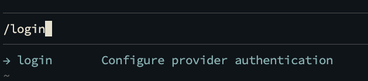
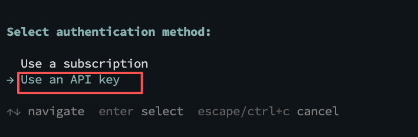
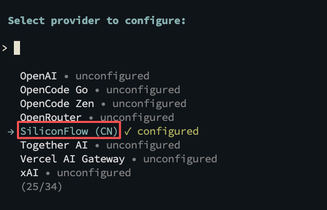
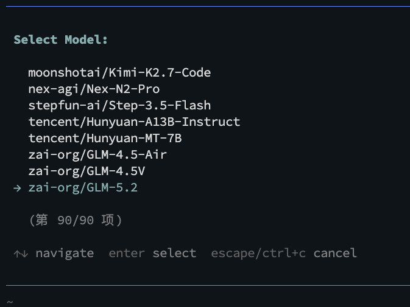
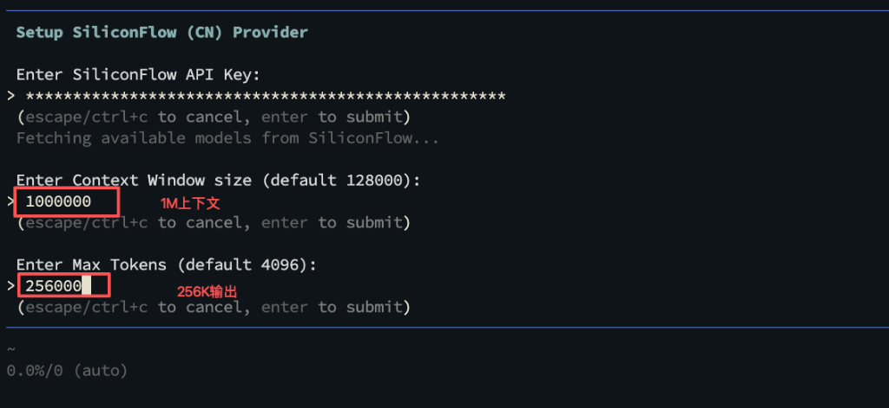
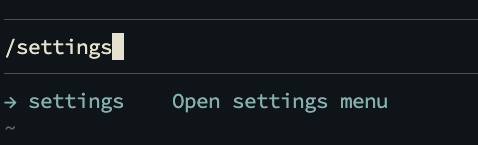
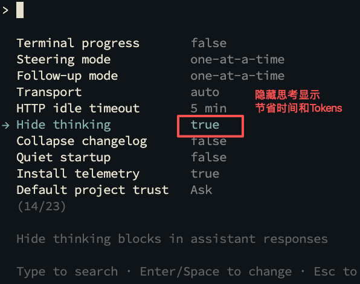

# fnx_dv AI CLI

> **芯片验证工程师专属的闭源智能编码 Agent 终端。**
> 免源码、零依赖，支持快速部署。

> [!IMPORTANT]
> **系统与工具链兼容性说明**：
> * **操作系统**：目前仅支持 **Linux** 系统（如 RedHat/CentOS/Ubuntu 等 64 位发行版），暂不支持 macOS / Windows。
> * **仿真工具**：UVM 编译与仿真环境目前仅支持 **VCS (Synopsys)**，暂不支持 ModelSim/Questa/Xcelium 等其他仿真器。

---

## 安装

> [!IMPORTANT]
> **已不支持在线安装。** 原来的 `curl … install.sh | bash` 现在只会提示「已不支持在线安装，请向管理员索取离线安装包」。
> 请向管理员索取离线安装包，解开后按包内 `README.txt` 操作。

有两种装法，都在离线包目录里执行：

```bash
# A. 装到指定目录，所有用户共用（管理员先建好 /tools/forenyx，由 root 或某个账号执行一次）
./install-release.sh --prefix /tools/forenyx

# B. 只给自己用，装到 ~/.forenyx
./install-release.sh
```

装到指定目录后：

```
/tools/forenyx/.forenyx/        所有用户共用，只放程序
├── forenyx-hostid.sh           申请授权时运行它
└── fnx_dv/
    ├── bin/fnx_dv              命令入口
    ├── libexec/                程序本体、加密的内置技能
    └── tools/                  fd、rg

~/.forenyx/                     每个用户自己的，首次运行 fnx_dv 时自动建好
├── .env                        设备标识、视觉模型配置、VENV_PYTHON
├── forenyx.lic                 授权文件（license import 导入后才有）
└── fnx_dv/agent/               设置、会话历史、自定义技能
```

* root 安装时会写入 `/etc/profile.d/forenyx.sh` 与 `forenyx.csh`，用户重新登录后直接输入 `fnx_dv`；普通账号安装时只改自己的 shell 配置文件，并打印这两个文件的内容供 root 放入。
* 每个用户首次运行 `fnx_dv` 时按提示申请授权：运行 `/tools/forenyx/.forenyx/forenyx-hostid.sh`，把输出发给管理员换取授权文件，再执行 `fnx_dv license import <授权文件>`。
* 配置目录可以用环境变量 `FORENYX_CODING_AGENT_DIR` 另行指定（例如每个 tmux 窗口一份配置），授权仍用 `~/.forenyx` 里的。

---

## 配置指南与最佳实践 (SiliconFlow 接入)

首次运行 `fnx_dv` 后，请按照以下步骤配置大模型及推理服务：

### 1. 配置 API 认证

在终端命令行输入 `/login` 开启登录向导：



选择 **`Use an API key`**（使用 API 密钥验证方式）进入下一步：



---

### 2. 选择服务提供商

导航至 **`SiliconFlow (CN)`**，按回车键选择。该服务商提供国内低延迟、高吞吐的大模型推理服务。



---

### 3. 选择高代码能力模型

在选定提供商后弹出的模型列表中，使用键盘的方向键上下导航，选择适合芯片验证代码生成的推理模型（如 **`zai-org/GLM-5.2`**），按回车键锁定。



---

### 4. 配置输入 Key 与上下文限制

输入您的 SiliconFlow API Key，随后根据验证代码生成的实际需求，配置运行参数：

* **Context Window (上下文窗口)**：输入 `1000000` (1M 上下文)。超长上下文能够完整容纳复杂的 UVM 验证环境及芯片设计规范 (Spec)。
* **Max Tokens (最大输出字节)**：输入 `256000` (256k 输出)，保障在生成大规模 UVM 验证案例 (Testcase) 时代码完整不截断。

> **⚠️ 注意**：此处配置的 `1000000` 和 `256000` 为当前示例模型 `GLM-5.2` 的上限参数。如果您选择了其他模型，请务必根据该模型官网发布的实际规格（如部分模型最大支持 128k 上下文或 4096 输出）进行配置，以免导致请求报错。



---

### 5. 优化推理响应速度 (节省 Tokens)

通过高级配置，可优化输出表现并减少 Token 消耗：

1. 在命令行中输入 `/settings` 打开高级设置菜单：



2. 导航至 **`Hide thinking`** 选项，按空格键或回车键将其修改为 **`true`**：
   * *💡 提示：开启该功能后，模型在输出时将隐藏思考过程（Thinking Process），从而加快响应速度并减少日常交互中的 Token 消耗。*



---

### 6. 配置内置技能 ic-docx2md 的多模态模型（可选）

如果您需要使用 `ic-docx2md` 内置技能（用于一键转换 Spec 文档 docx 到 Markdown），需要为其配置专用的 API 密钥 和多模态模型：

直接编辑安装时自动初始化生成的全局配置文件：安装目录下的 **`.env`**（默认 `~/.forenyx/.env`；用 `--prefix` 装到别处的，把 `~/.forenyx` 换成您的安装目录）：

```bash
vi ~/.forenyx/.env
```

将 `OPENAI_API_KEY` 替换为您的实际 API Key（默认以 SiliconFlow 接入），其余配置按需调整后保存即可：

```ini
OPENAI_API_KEY="YOUR-API-KEY"
OPENAI_API_BASE="https://api.siliconflow.cn"
ARK_MODEL_NAME='Qwen/Qwen3.5-397B-A17B'
MAX_OUTPUT_TOKENS=32768
TEMPERATURE=0.1
```

---

配置完成后，即可开始使用 fnx_dv 客户端进行芯片验证辅助编码。

---

## 运维命令

### 升级

不支持 `fnx_dv update`（执行时只会说明升级方法）。向管理员索取新版离线包，按原来的装法重新执行安装命令；装到指定目录的写同一个 `--prefix`，由安装账号执行，升级前请通知用户退出。各用户 `~/.forenyx` 里的授权与配置都会保留。

### 卸载

```bash
fnx_dv uninstall
```

* 装到指定目录时，只有安装账号（或 root）能卸载，其他用户执行会提示「你没有删除权限，请联系安装账号」。卸载不动任何用户自己的 `~/.forenyx`。
* 以前在线安装的机器，也可以用本仓库的卸载脚本：

```bash
curl -fsSL https://raw.githubusercontent.com/HwJhx/forenyx-releases/main/uninstall.sh | bash
```

---

## 📚 Skills 汇总

fnx_dv 带 26 个 skill 和 1 个内置命令 `/uvm-testcase-auto`（直接输入，不用 `/skill:`）。**自 0.4.12 起，各 skill 的输入由平台在启动 fnx_dv 时以环境变量给出**（见下一节），调用时不用再给路径参数；`ic-docx2md` 除外，调用时给输入、输出路径。

| Skill | 类别 | 输入 ➔ 输出 | 归属工作流 |
| :--- | :--- | :--- | :--- |
| **`ic-docx2md`** | 规格抽取 | `.docx` / `.pdf` 文档 ➔ Markdown 规范与图片目录（调用时给输入、输出路径；一般由平台准备规格书时使用） | 1. 架构审计 |
| **`ic-audit-spec`** | 架构审计 | 设计规格 + 寄存器描述 ➔ Spec 质量审查报告（有状态机时另出 FSM 审查报告） | 1. 架构审计 |
| **`ic-audit-prd-spec`** | 需求对比 | PRD + 设计规格 + 寄存器描述 ➔ 需求验证报告 | 1. 架构审计 |
| **`ic-audit-soc-prd-spec`** | 需求对比 | SoC PRD + SoC 规格 + 芯片寄存器描述（选用） ➔ SoC 级需求验证报告 | 1. 架构审计 |
| **`ic-audit-soc-spec`** | 架构审计 | SoC 规格 + 芯片寄存器描述（选用） ➔ IP 级 / 连接级 / 系统级三份 SoC Spec 质量审查报告 | 1. 架构审计 |
| **`ic-audit-design-auto`** | 编排 | 依次调用 `ic-audit-prd-spec`、`ic-audit-spec` ➔ 分阶段审计报告 | 1. 架构审计 |
| **`uvm-testplan-gen-feature`**| 验证计划 | 设计规格 + 寄存器描述 ➔ 功能点报告 `doc/uvm_feature_report.md` | 2. 测试计划 |
| **`uvm-testplan-gen-testplan`**| 验证计划 | 已审核功能点报告 + 设计规格 ➔ 验证计划 `doc/uvm_testplan.md` | 2. 测试计划 |
| **`uvm-testplan-auto`** | 编排 | 依次调用 `gen-feature`、`gen-testplan` ➔ 功能点报告与验证计划 | 2. 测试计划 |
| **`uvm-env-create`** | 环境搭建 | IP 名 + RTL 清单 + VIP 清单 + 寄存器描述 ➔ UVM 骨架与冒烟测试 | 3. 环境构建 |
| **`uvm-env-cfg`** | 环境搭建 | 总线协议记录 ➔ `{ip}_env.sv`、`{ip}_env_cfg.sv` | 3. 环境构建 |
| **`uvm-env-config-db`** | 环境搭建 | `tb_top` 虚接口 ➔ `uvm_config_db::set` 注入 | 3. 环境构建 |
| **`uvm-env-inf-connect`** | 环境搭建 | RTL 端口列表 ➔ `{ip}_inf_connect.sv` 接口文件 | 3. 环境构建 |
| **`uvm-env-impl`** | 环境搭建 | RTL + 设计规格 + 验证计划 + VIP ➔ 完整 Driver/Monitor/Scoreboard（编排 inf-connect 等子 skill） | 3. 环境构建 |
| **`uvm-env-sva`** | 断言构建 | 验证计划 + RTL ➔ `sim/sva/*.sv` & `bind` | 3. 环境构建 |
| **`uvm-env-coverage-add`** | 环境搭建 | 覆盖模型补建清单 + 验证计划 ➔ 增量补建 `{ip}_coverage.sv`（`COV=1` 编译验证，不跑仿真） | 5. 覆盖率收敛 |
| **`uvm-env-base-seq-gen`** | 序列生成 | IP 名称 + 协议 ➔ `{ip}_base/smoke_sequence.sv` | 4. 用例与仿真 |
| **`uvm-testcase-gen-testcase`**| 用例生成 | 验证计划 + `[TC_NAME]` ➔ TC 类 & Virtual Seq | 4. 用例与仿真 |
| **`uvm-testcase-compile-sim`**| VCS 仿真 | `<TC>` ➔ 修 Lint 运行 VCS 输出 Log | 4. 用例与仿真 |
| **`uvm-testcase-debug-failure`**| 日志 RCA | `com.log` / `run.log` ➔ AI 自动修编译错或出 RCA 报告 | 4. 用例与仿真 |
| **`uvm-testcase-wave-rca`** | 波形 RCA | FSDB 波形 + `run.log` ➔ 链式迭代根因分析报告 | 4. 用例与仿真 |
| **`uvm-fsdb-wave-extract`** | 波形提取 | FSDB 波形 + 信号名 ➔ 跳变历史 JSON 数据文件 | 4. 用例与仿真 |
| **`/uvm-testcase-auto`**（内置命令） | 编排 | 验证计划 ➔ 逐 TC 生成、编译与汇总（不带参数，支持断点续跑） | 4. 用例与仿真 |
| **`uvm-coverage-closure`** | 覆盖率 | VCS 覆盖率报告 + 验证计划 ➔ 缺口分析报告（两张人工裁决表）+ 验证计划补充条目 | 5. 覆盖率收敛 |
| **`uvm-progress-tracker`** | 验证管理 | 回归/覆盖率数据 ➔ 维护 `uvm_progress.json`（每阶段 `start_time` / `duration`） | 5. 覆盖率收敛 |
| **`uvm-progress-chart`** | 可视化 | 进度 JSON ➔ 趋势折线图 (`.drawio` + `.png`) | 5. 覆盖率收敛 |
| **`uvm-report-gen-concise`** | 验证报告 | 覆盖率报告 + 验证计划 + RTL + 进度 JSON（后三项有则用） ➔ `doc/<IP>_uvm_verification_report.docx`（不含缺陷章节）+ 待确认项 | 5. 覆盖率收敛 |

---

## ⚙️ 环境变量

### 平台环境变量（FNX_*）

* **一个 IP 启动一个 fnx_dv**，启动前在该进程的环境里设好下表的 IP 级变量；芯片级审查另起一个 fnx_dv，设芯片级变量。
* 值都是字符串；除 `FNX_IP_NAME`、`FNX_DUT_TOP` 是名字外，其余都是以 `/` 开头的绝对路径。
* 每个 skill 开始时检查本次用到的变量，缺失或不合法就一次列出全部问题后停止。标「选用」的没设就不用，设了也要合法。
* 只在启动时读取，改了变量要重新启动 fnx_dv。

未标「选用」的变量，在用到它的 skill 里都是必需的。

### IP 级

| # | 变量名 | 作用 | 格式要求 |
|---|---|---|---|
| 1 | `FNX_IP_NAME` | 本会话对应的 IP 名，如 `gsc` | 字母开头，只含字母、数字、下划线 |
| 2 | `FNX_IP_DIR` | IP 目录，如 `/proj/chipA/verif/gsc`。验证环境生成在这里，文档写在其下的 `doc/` | 目录名必须等于 `FNX_IP_NAME`。可以还不存在（首次审查 spec、生成验证计划时），但上一级目录必须存在且可写 |
| 3 | `FNX_SETUP_CSH` | 平台的环境加载脚本（csh），编译、仿真、看波形前加载 | fnx_dv 先进入 `FNX_IP_DIR` 再 source 它；加载后须满足下面「setup 脚本加载后须具备的」 |
| 4 | `FNX_VIP_LIST` | 平台已有 VIP 的清单（纯文本文件） | 每行一个 VIP 目录的绝对路径，空行和 `#` 开头的行忽略，每个目录都须存在。须包含 `clk_rst_uvc`、`tilelink_uvc_v2.1`、`flx_vip`（验证环境模板固定使用；平台没有的，可由工程师放进 `FNX_IP_DIR/vip/`） |
| 5 | `FNX_RTL_FILELIST` | 本 IP 的 RTL 文件清单（`.f`），编译和读 RTL 都用它 | 文件名为 `<IP 名>.f`（不区分大小写）；只用绝对路径；不嵌套 `-f` / `-F`；路径中不含 `$` 变量；DUT 的 RTL 逐个文件列出（或用 `-v`），可分布在多个目录；`-y` 只用于库目录。允许 `+incdir+`、`+define+`、`+libext+`、`-v`、`-y`、`//` 与 `#` 注释 |
| 6 | `FNX_RTL_TOP_FILE` | DUT 顶层模块所在的 RTL 文件（`.v` / `.sv`） | 须出现在 `FNX_RTL_FILELIST` 中（文件行或 `-v`） |
| 7 | `FNX_DUT_TOP` | DUT 顶层模块名，用于在 testbench 里例化 DUT、绑定断言 | 须是 `FNX_RTL_TOP_FILE` 中定义的一个 `module` |
| 8 | `FNX_REG_XML` | 寄存器描述（IP-XACT 格式 XML） | 可读文件 |
| 9 | `FNX_SPEC_FILE` | 设计规格文档（Markdown） | 可读文件。原件是 Word / PDF 时，由平台先用 `ic-docx2md` 转成 Markdown |
| 10 | `FNX_IP_PRD_FILE` | IP 的 PRD（`.yaml`），spec 审核以它为基准 | 可读文件 |
| 11 | `FNX_KB_FILE`（选用） | 用例知识库（Markdown，用户维护），生成用例、诊断失败时参照 | 设置了则须为可读文件；未设置时跳过知识库步骤 |
| 12 | `FNX_CHISEL_DIR`（选用） | Chisel 源码目录，生成验证计划时从中提取状态机等 | 设置了则须为可读目录；未设置时只用 RTL |

### 芯片级

| # | 变量名 | 作用 | 格式要求 |
|---|---|---|---|
| 13 | `FNX_SOC_DIR` | 芯片级工作目录，审查报告写在其下的 `doc/` | 可以还不存在，但上一级目录必须存在且可写 |
| 14 | `FNX_SOC_SPEC_FILE` | SoC 规格说明书（Markdown） | 可读文件 |
| 15 | `FNX_SOC_PRD_FILE` | SoC PRD（`.yaml`） | 可读文件 |
| 16 | `FNX_SOC_REG_FILE`（选用） | 芯片寄存器描述（`.svd` / `.xml` 等） | 设置了则须为可读文件；未设置时审查范围相应缩小 |

### setup 脚本加载后须具备的

不是单独设给 fnx_dv 的变量，而是 `FNX_SETUP_CSH` 执行后应当具备的条件；缺少时同样停止，并说明缺了什么。

| 项 | 说明 | 何时需要 |
|---|---|---|
| `vcs` 命令 | 在 `PATH` 中能找到 `vcs` | 编译、仿真 |
| `DC_HOME` | Design Compiler 安装目录（其下 `dw/sim_ver` 为 DesignWare 仿真模型） | 编译 |
| `VERDI_HOME` | Verdi 安装目录。读取波形时从中自动查找 Verdi 自带的 Python | 看波形、带波形编译时 |
| `DESIGNWARE_HOME` | Synopsys DesignWare（SVT VIP）安装目录 | 用到 Synopsys SVT VIP 时 |

### VENV_PYTHON

首次调用需要执行 Python 脚本的 skill 时，系统会交互式提示你填写，填好后保存在 `~/.forenyx/.env`，fnx_dv、fnx_sw 共用，后续无需再次填写。终端里设了同名环境变量时以终端的为准：root 可在 `/etc/profile.d/` 里统一 `export VENV_PYTHON=...`，所有用户都不用再填。

| 变量 | 说明 |
| --- | --- |
| `VENV_PYTHON` | Python 环境的根目录（其下要有 `bin/python3`），如 `/home/zhang/miniconda3`。系统 Python 填 `/usr` |

> **波形 skill（`uvm-testcase-wave-rca` / `uvm-fsdb-wave-extract`）不走 `VENV_PYTHON`**：它们用 Verdi 自带的 NPI Python 环境，需在**仿真主机（Linux）**上设 `VERDI_HOME`（如 `/opt/synopsys/verdi/W-2024.09-SP1`），其余（`LD_LIBRARY_PATH` 含 Qt5、`PYTHONPATH`、`$VPY`）由 `uvm-fsdb-wave-extract/scripts/setup_env.csh` 自动配好。需 Verdi license。

---

## ⚖️ 开源致谢与授权声明

fnx_dv AI CLI (Based on Pi) 是基于开源项目 [earendil-works/pi](https://github.com/earendil-works/pi) 进行二次开发与定制的闭源商业分发版本。我们对 `pi` 及其开源社区的杰出工作表示由衷的感谢。

根据 **MIT 许可证 (MIT License)** 的合规要求，在此保留并附带原项目的版权声明及许可条款全文：

```text
MIT License

Copyright (c) 2025 Mario Zechner

Permission is hereby granted, free of charge, to any person obtaining a copy
of this software and associated documentation files (the "Software"), to deal
in the Software without restriction, including without limitation the rights
to use, copy, modify, merge, publish, distribute, sublicense, and/or sell
copies of the Software, and to permit persons to whom the Software is
furnished to do so, subject to the following conditions:

The above copyright notice and this permission notice shall be included in all
copies or substantial portions of the Software.

THE SOFTWARE IS PROVIDED "AS IS", WITHOUT WARRANTY OF ANY KIND, EXPRESS OR
IMPLIED, INCLUDING BUT NOT LIMITED TO THE WARRANTIES OF MERCHANTABILITY,
FITNESS FOR A PARTICULAR PURPOSE AND NONINFRINGEMENT. IN NO EVENT SHALL THE
AUTHORS OR COPYRIGHT HOLDERS BE LIABLE FOR ANY CLAIM, DAMAGES OR OTHER
LIABILITY, WHETHER IN AN ACTION OF CONTRACT, TORT OR OTHERWISE, ARISING FROM,
OUT OF OR IN CONNECTION WITH THE SOFTWARE OR THE USE OR OTHER DEALINGS IN THE
SOFTWARE.
```
